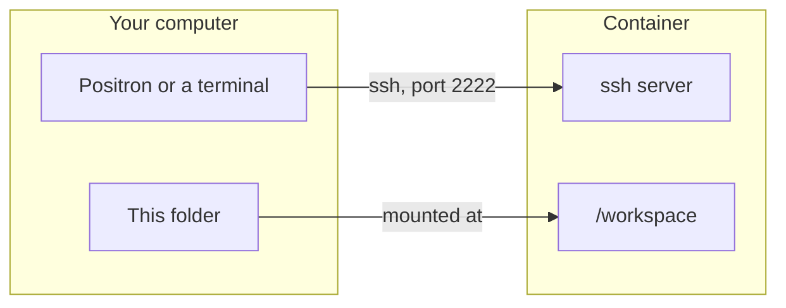

# docker-uv-renv

An example project for UBC's DSCI 522 and DSCI 310,
which use the textbook
[Reproducible and Trustworthy Workflows for Data Science](https://ubc-dsci.github.io/reproducible-and-trustworthy-workflows-for-data-science/).
You work inside a Docker container, over ssh.

- Python packages: `pyproject.toml`, locked in `uv.lock`
- R packages: `DESCRIPTION`, locked in `renv.lock`
- Reports: Quarto, in `reports/`, as HTML and PDF (Typst, no LaTeX)

Run `make` to see the commands.



## Start

1. Make an ssh key if you don't have one: `ssh-keygen -t ed25519`
2. `make build`
3. `make up`
4. `make shell` opens a terminal in the container, in `/workspace`
   - Or log in over ssh: `make ssh`, then `cd /workspace` (see below optional step)

`/workspace` is this folder: change a file in one and it changes in the other.
`make down` stops the container.

Port 2222 on your computer goes to ssh's port, 22, in the container.
Your computer may already use 22.
To change it, edit `docker-compose.yml` and the `Makefile`.

## Connect with Positron

Open the Command Palette,
run "Remote SSH: Show Remote Menu",
pick "Connect to Host",
and type `root@localhost:2222`.
Open `/workspace`.
For Python, pick `/opt/venv/bin/python`.

## Add a package

In the container, in `/workspace`:

```bash
uv add scikit-learn
```

```r
renv::install("tidyr")
packageVersion("tidyr")   # add tidyr (== that version) to DESCRIPTION
renv::snapshot()
```

Then `make build` and `make up` on your computer,
and commit `pyproject.toml`, `uv.lock`, `DESCRIPTION` and `renv.lock`.

If an R package won't install,
`renv::sysreqs("tidyr")` lists the Ubuntu packages it needs.
Add them to the `Dockerfile`.

## Render the reports

`uv run quarto render` in the container,
or `make render` from your computer.
The HTML and PDF files go in `reports/`.

## If something goes wrong

- `~/.ssh/id_ed25519.pub` is a folder:
  Docker made it because the key didn't exist yet.
  Delete the folder, make the key, try again.
- Your key has a different name: change it in `docker-compose.yml`.
- Positron says the host key changed: you rebuilt the image.
  Run `ssh-keygen -R "[localhost]:2222"`, then connect again.

## Run one command with `docker run`

`make up` runs the image's `CMD`, the ssh server.
Type a command after the image name and it runs instead:

```bash
docker run --rm -it docker-uv-renv bash    # bash, no ssh server. -it: so you can type
docker run --rm -v "$PWD:/workspace" docker-uv-renv uv run quarto render
```

`-v` mounts this folder at `/workspace`, as `docker-compose.yml` does.
The packages are installed in `/opt`, not `/workspace`,
because the mount hides whatever the image put there.

Replaces [docker-condalock-jupyterlab](https://github.com/chendaniely/docker-condalock-jupyterlab).


## Optional: an ssh shortcut

`make ssh` runs this:

```bash
ssh -p 2222 -o StrictHostKeyChecking=no -o UserKnownHostsFile=/dev/null root@localhost
```

The two `-o` options skip the host key check,
because the container's key can change when the image is rebuilt.
To type `ssh docker-uv-renv` instead,
and pick `docker-uv-renv` from a list in Positron,
add this to `~/.ssh/config`:

```
Host docker-uv-renv
  HostName localhost
  Port 2222
  User root
  StrictHostKeyChecking no
  UserKnownHostsFile /dev/null
```
